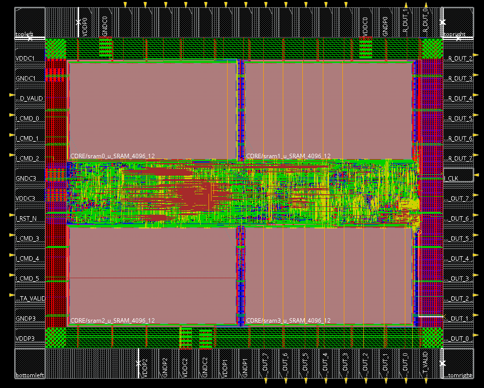

# Lab11 mini ISP APR

## design: 
RTL 沿用 Lab02，差別是我把bilinear的shift register也變成獨立一組的電路。

這次的 lsc gain map是直接給數值，不是透過input傳入，所以我改用動態選址取代shift register，因為當一個array是固定數值時，用動態選址會比shift register有更低的面積，而如果是input data就是shift register比較好，所以不能無腦用shift register。

## APR: (APR_1.cmd ~ APR_3.cmd是我最終跑的腳本，應該可以直接拿來改)
Floorplan aspect 0.77、utilization 0.86。四顆 SRAM 放四個角，下面兩顆轉180度往上。

優化面積的技巧：
1. aspect ratio可以調，如果像這次有上下各兩顆sram，那那兩顆sram間的位置其實也很難放甚麼cell，效率不高，所以可以 aspect ratio 調成晶片的寬度幾乎就是兩顆sram的大小，讓cell可以被集中place在中間的長方形，這樣可以拉高utilization，把讓面積低一點。
2. 雖然在真的下晶片不能這樣亂搞，但在這個lab可以用最低數量的power pad，然後core ring的組數可以少一點，pad to core boundary小一點，這樣 chip area都會小很多。

降低 cycle time 的技巧:
1. clock的pin腳位置很重要，盡量靠中間一點，離所有的cell都平均一點，像我是放在右邊的中間位置。我原本隨便放只有12ns，最後是9.8ns。
2. output pin的位置很重要，因為output pin的latency比較大，通常都會是 critical path，盡量集中在某一個角落，這樣你output logic相關的cell也可以被放到那附近，不會距離太遠，像我是集中放在右邊跟下面。
3. 因為output pin真的delay很大，最後的critical path會都是output pin，所以rank1的作法是在輸出後會多檔一層register，讓output register可以中間再放一個多的register、最後再到output pin，有機會讓EDA的placement優化，讓critical path更低，我有想過但懶得弄。我的優化方法主要是一直微調位置，讓pin角集中在某處。

我的 chip layout:

## Performance

- Rank 2 / Score 99.59
- CT 9.8 / Latency 17792 / Area 3654259
- Cost: \(CT \times Latency \times Area\)
